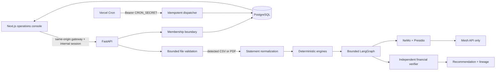

# FinPilot — Neuro-Symbolic Financial Decision Intelligence

FinPilot is a production-oriented, tenant-isolated financial intelligence application for Agent Arena 2026 Track 02. Deterministic Python engines own financial truth; specialized LangGraph agents use the sponsor Mesh API only for bounded semantic reasoning. Independent code verifies every recommendation before release.

[Implementation status](docs/IMPLEMENTATION_STATUS.md) is the source of truth for verified results and blockers. No hosted deployment, live Mesh run, or regulatory certification is implied.

## Working features

- Passwordless synthetic-workspace entry in the web console; internal short-lived authorization and server-derived tenant isolation remain enforced by the API.
- Content-validated CSV and text-PDF ingestion with explicit mappings, parser provenance, row errors, exact minor units, transfers/refunds, source evidence, and idempotent replay.
- Recurrence, robust anomaly detection, immutable snapshots, chronological backtests, 30/60/90-day forecasts, and what-if branches.
- Typed LangGraph analyst, advisor, critic, and verifier flow. All model inference uses Mesh; no provider fallback exists.
- Deterministic input/tool policy, NeMo Guardrails, Presidio minimization, fail-closed output verification, and persisted audit events.
- Versioned governance assets, risk/evaluation gates, human-review queue, exact recommendation lineage, and governance UI.
- Durable timezone-aware weekly digests with signed Vercel Cron dispatch, SQL locking, dedupe keys, and in-app delivery audit.
- Responsive glass-material product with distinct Live Demo, operational Console, and How it works modes; light/dark themes, ⌘K command palette, interactive SVG charts, and complete finance, audit, governance, and digest views.
- Empty passwordless statement workspace plus an explicitly selected, upload-ready fictional bank CSV (`apps/web/public/samples/finpilot-demo-bank-statement.csv`) that exercises the real ingestion, analytics, and validation paths without preloaded financial values.

## Local quickstart

Prerequisites: Docker with Compose, or Python 3.12 plus uv 0.7.13 and Node 22 plus pnpm 10.18.3.

```bash
cp .env.example .env
# Replace SESSION_SECRET and CRON_SECRET with separate random 32+ character values.
make setup
make lint typecheck test security-test
make docker-up
curl http://localhost:8000/ready
```

Open `http://localhost:3000`. Interactive API documentation is at `http://localhost:8000/docs`.

`MESH_API_KEY` is needed only for live agent inference. Tests inject an explicitly fake Mesh transport; production code refuses direct provider endpoints. Use synthetic data for public demonstrations.

## Architecture



See [system design](docs/architecture/system-design.md), [agent workflow](docs/architecture/agent-workflow.md), and [financial engines](docs/architecture/financial-engines.md).

## API surface

All product endpoints are under `/api/v1`. The web console provisions an isolated synthetic workspace through `/workspace/bootstrap` and carries the resulting short-lived internal session automatically; users do not enter credentials. Major groups are workspaces, accounts/uploads/transactions, analytics snapshots/forecasts/scenarios, agent runs, governance, and digests/notifications. The digest dispatcher is authenticated separately with `CRON_SECRET`.

See [API guide](docs/api/README.md) and generated OpenAPI for the exact contract.

## Verification

```bash
cd apps/api
.venv/bin/ruff check app tests
.venv/bin/mypy app
.venv/bin/pytest -q --cov=app

cd ../web
node_modules/.bin/eslint src --max-warnings=0
node_modules/.bin/tsc --noEmit
node_modules/.bin/next build

cd ../..
docker compose config --quiet
git diff --check
```

The latest verified command results, test count, migration head, and browser evidence are recorded in [implementation status](docs/IMPLEMENTATION_STATUS.md). The bounded offline Promptfoo corpus passed 184/184 cases (168 attacks and 16 legitimate controls). Detailed evaluation evidence is in [evaluation results](docs/evaluation/results.md).

## Deployment and limitations

Two Vercel project roots are prepared: `apps/api` and `apps/web`. Deployment needs managed PostgreSQL, project environment variables, Vercel authentication, migrations, and observed production checks. See [Vercel runbook](docs/deployment/vercel.md) and [environment variables](docs/deployment/environment-variables.md).

Known blockers include the not-yet-run Mesh model-based red team, unverified Vercel bundle/runtime size, missing hosted deployment evidence, and one upstream Debian zlib high-severity image finding without a fixed package. See [known limitations](docs/security/known-limitations.md).

## Documentation map

- [Demo runbook](docs/demo.md)
- Decision records: [ADR 0001 deterministic financial authority](docs/adr/0001-neuro-symbolic-boundary.md) and [ADR 0002 stateless digest dispatch](docs/adr/0002-stateless-digest-dispatch.md)
- Security: [threat model](docs/security/threat-model.md), [guardrail architecture](docs/security/guardrail-architecture.md), [prompt-injection defense](docs/security/prompt-injection-defense.md), [agent permissions](docs/security/agent-permissions.md), [data privacy](docs/security/data-privacy.md), [testing](docs/security/security-testing.md), and [known limitations](docs/security/known-limitations.md)
- Governance: [charter](docs/governance/governance-charter.md), [risk register](docs/governance/risk-register.md), [model and prompt registry](docs/governance/model-and-prompt-registry.md), [model cards](docs/governance/model-cards.md), [human oversight](docs/governance/human-oversight.md), [change management](docs/governance/change-management.md), [drift monitoring](docs/governance/drift-monitoring.md), and [incident response](docs/governance/incident-response.md)
- Deployment: [local Docker](docs/deployment/local-docker.md), [Vercel](docs/deployment/vercel.md), and [environment variables](docs/deployment/environment-variables.md)
- Evaluation: [methodology](docs/evaluation/methodology.md), [results](docs/evaluation/results.md), and the [Promptfoo lanes](evaluation/promptfoo/README.md)
