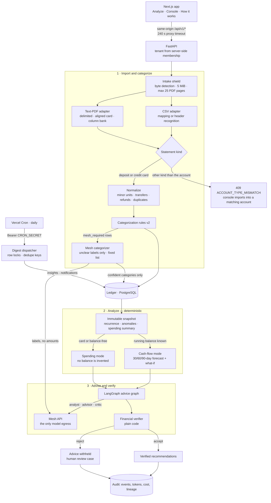
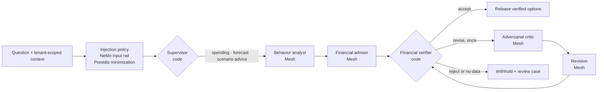

# FinPilot — Neuro-Symbolic Financial Decision Intelligence

FinPilot reads a bank or credit-card statement and returns spending and cash-flow advice in which every amount has been checked in code. It is a tenant-isolated application built for Agent Arena 2026 Track 02.

The split between code and model is strict. Deterministic Python owns every number: parsing, recurrence, anomalies, forecasts, and spending summaries. Specialized agents call the sponsor Mesh API for two things only. They propose categories for statement labels the keyword rules cannot place, and they explain the computed evidence and draft options. An independent verifier, written in plain code, checks each recommendation's amounts, evidence citations, and currency before release. Advice that fails is withheld.

[Implementation status](docs/IMPLEMENTATION_STATUS.md) is the source of truth for verified results and blockers. Live Mesh advice and categorization runs have been exercised on synthetic data only. The model-based Mesh red team has not been run, and there is no hosted deployment. Nothing here implies regulatory certification.

## How a statement flows through FinPilot



1. **Import and categorize.** The intake shield detects the real format from the file's bytes, then checks that the extension and MIME type agree with it. It enforces size, row, and PDF structure budgets. Renamed, encrypted, active-content, attachment-bearing, malformed, scanned, and over-budget files fail closed with stable error codes. The CSV or text-PDF adapter extracts rows with parser and source-line provenance. Amounts become exact integer minor units. Transfers, refunds, and duplicate rows are classified, and replaying the same upload returns the original import. A statement whose rows carry a running balance is a `deposit` account. Card statements are `credit_card`. Card and bank rows are never mixed in one account. Rules (`categorization-rules-v2`) label each row, and rows they cannot place are flagged `mesh_required`. When **Run FinPilot** starts, those rows go to the Mesh categorizer, which proposes one category from a fixed list for each distinct label. The labels are bounded, screened, Presidio-minimized and de-duplicated, and carry no amounts. Code applies a proposal only when it fits the row's debit or credit direction and has at least 70% confidence. Applied rows are stored as `mesh` with confidence capped at 85%, below the rules' 90%. The run saves every answer, applied or not, with the previous category. A reviewer can still correct any category with recorded lineage, and a human correction is never overwritten. Import itself never calls Mesh. If the categorizer fails, analysis continues with the rule categories.
2. **Analyze.** A snapshot (`financial-v3`) freezes the evidence for one account and one as-of date. It records recurring patterns, robust anomalies, and a spending summary: totals, monthly pace, top categories and merchants, the monthly saving from a 20% cut, recurring charges, and, for bank accounts, net flow and savings rate. Bank statements run in `cashflow` mode and can produce 30/60/90-day daily forecasts and what-if branches. Card and balance-free statements run in `spending` mode with a null opening balance. A forecast request against them returns 422.
3. **Advise and verify.** An agent run is grounded in exactly one forecast (with an optional scenario) or one snapshot. The graph below produces typed recommendations, and the verifier decides whether any of them is released.

## Advice graph



- **Context.** The service assembles the context from the tenant's own snapshot, forecast, and scenario records. Model context keeps only the ten strongest anomalies. Merchant labels taken from statements are untrusted: they are cut to 48 characters, screened by the injection policy, and cited by neutral evidence IDs. The context also lists the only evidence IDs and minor-unit amounts that advice may cite.
- **Routing.** The supervisor is deterministic. A scenario routes to `scenario_advice`, a forecast to `forecast_advice`, and anything else to `spending_advice`.
- **Mesh calls.** A run makes two Mesh calls, or four when a revision is needed. Each call requests a strict JSON Schema derived from the specialist's Pydantic output model, and a reply cut off at the token limit fails closed. Every completion passes the NeMo output rail. The rail blocks credential tokens, secret disclosure, and positive certainty claims such as "guaranteed savings". Negated disclaimers such as "not guaranteed" pass.
- **Verification.** Each recommendation must cite only allowed evidence IDs, use only precomputed amounts and the snapshot's currency, and avoid certainty words. One revision is allowed: the critic challenges the rejected draft and the advisor rewrites it. A second failure withholds the advice and opens a high-risk human-review case.
- **Audit.** Every node event is persisted with its model, latency, input/output/cached/reasoning tokens, and cost exactly as Mesh reports it, together with the recommendations, verifications, and the exact governance artifact versions used. Failures record a fixed provider reason and HTTP status, or the name of the guardrail rule that fired, never model text.

Agents cannot move money, trade, purchase, cancel services, run code, shell, or SQL, or gain tools at runtime.

## Product

The web app opens without a login. The browser calls `POST /api/v1/workspace/bootstrap`, which creates an empty, isolated workspace and returns a short-lived token. The API still derives the tenant from server-side membership. No financial data is preloaded.

- **Analyze** is the default screen, designed as an AI copilot. Drop in a statement, or try the bundled sample. A six-stage map shows Import → Categorize → Analyze → Forecast → Advise → Verify. After import, a briefing lists deterministic highlights computed from ledger rows, and the Rhythm daily spending calendar and Spend mix panels appear. **Run FinPilot** sends unclear rows to the Mesh categorizer, takes a snapshot, adds a forecast for bank accounts, and starts the agent run. A live pipeline track follows the run, ending in a chat-style answer: a verified badge, ranked recommendations with confidence and evidence counts, and an expandable persisted event trace. If the advisor fails, the deterministic results stay on screen with an explanation and an in-place retry.
- **Console** holds the full workspace views:
  - **Overview** and **Ledger**: provenance, filters, and a category correction drawer.
  - **Forecast**: horizon choice and what-if presets.
  - **Advisor** and **Audit trail**: per-call Mesh tokens, cache, reasoning, latency, and billed cost.
  - **Governance**: readiness cards, registry, risks, evaluations, and the review queue.
  - **Digests**: weekly check-in schedule and delivery audit.
- **How it works** renders the architecture from `GET /api/v1/system/architecture`. It is served from the same manifest that builds the LangGraph, and it can replay the latest run's persisted events.

The app has light and dark themes, a ⌘K command palette, and a layout that works down to 390 px. The old `/forecast` and `/transactions` routes redirect to `/`.

## Statement support

- **CSV:** if the configured mapping's headers are present, it is used. Otherwise FinPilot finds the header row after bank preamble lines. It maps common labels (Narration, Particulars, Withdrawal/Deposit, Debit/Credit, Dr/Cr, Amount, Closing Balance) and infers the date format from the data. Ambiguous dates are read day-first, and the upload records a warning. Amounts may carry `₹`/`Rs.`/`INR`, `Cr`/`Dr` suffixes, or `0.00` placeholders. Decimal-comma amounts are rejected per row. ICICI, SBI, Axis, and Kotak export styles are covered without bank-specific code.
- **PDF (embedded text only):** three table styles are supported:
  - delimited tables
  - visually aligned card tables with per-row debit/credit markers
  - column-aligned bank tables with withdrawal, deposit, and balance columns in either order

  Split dates and wrapped details are read in page order, using each page's transformation matrix, so flipped-coordinate PDFs and continuation pages without a header work. Rows may be vertically centred. Text drawn as many small glyph pieces is rebuilt from per-operator positions. `B/F` and total rows are skipped. Scanned PDFs return `PDF_OCR_REQUIRED`. Statements are never sent to an external OCR service.

The [demo runbook](docs/demo.md) has the full rules and reproducible fixtures.

## Local quickstart

Prerequisites: Docker with Compose, or Python 3.12 with uv 0.7.13 and Node 22 with Corepack-managed pnpm 10.18.3.

```bash
cp .env.example .env
# Replace SESSION_SECRET and CRON_SECRET with separate random 32+ character values.
make setup
make docker-up
curl http://localhost:8000/ready
make smoke            # deterministic end-to-end check of the running stack, no Mesh calls
```

Open `http://localhost:3000`. Interactive API documentation is at `http://localhost:8000/docs`. For a repeatable demo, upload [apps/web/public/samples/finpilot-demo-bank-statement.csv](apps/web/public/samples/finpilot-demo-bank-statement.csv) or the synthetic [evaluation/datasets/phase2_golden.pdf](evaluation/datasets/phase2_golden.pdf). Use only synthetic data in public demonstrations.

Import, analysis and forecasts work without Mesh. Rows the rules cannot place then keep their fallback category. Semantic categorization and advice need `MESH_API_KEY` and `MESH_MODEL`. Tests inject an explicitly fake Mesh transport, and production code refuses any model endpoint other than `https://api.meshapi.ai`. There is no provider fallback.

## Configuration

| Variable | Purpose |
|---|---|
| `DATABASE_URL` | Async PostgreSQL URL (`postgresql+asyncpg://…`) |
| `SESSION_SECRET` | Signs short-lived access tokens; 32+ characters |
| `ACCESS_TOKEN_MINUTES` | Token lifetime, 5–1440 (default 30) |
| `ALLOWED_ORIGINS` | CORS origins for the API |
| `MESH_API_KEY`, `MESH_MODEL` | Mesh credential and allowlisted model (the example uses `openai/gpt-5-mini`) |
| `MESH_BASE_URL` | Must be `https://api.meshapi.ai/v1` |
| `MESH_TIMEOUT_SECONDS` | Per-call timeout, up to 60 (default 20) |
| `MESH_REASONING_EFFORT` | `none`, `minimal`, `low` (default), `medium`, or `high`. Blank disables reasoning and sends temperature 0 |
| `CRON_SECRET`, `DIGEST_DISPATCH_LIMIT` | Digest dispatcher bearer secret (32+ characters) and batch size |
| `API_INTERNAL_URL` | Where the Next.js gateway forwards `/api/v1/*` |
| `NEXT_PUBLIC_API_BASE_URL` | Optional browser-visible API origin. Leave blank to use the same-origin gateway |

See [environment variables](docs/deployment/environment-variables.md).

## API surface

All product routes are under `/api/v1`. Tenant routes need the bearer token and `X-Tenant-ID`, and database membership is authoritative. Another tenant's object returns 404.

| Group | Routes |
|---|---|
| Workspace and auth | `POST /workspace/bootstrap`, `GET /auth/me` (`/auth/register` and `/auth/login` remain for API clients) |
| Accounts | `GET` and `POST /accounts` with `deposit`, `credit_card`, or `unknown` type |
| Statements and ledger | `POST /accounts/{id}/transaction-uploads`, `GET /transaction-uploads/{id}`, `GET /transactions?account_id=`, `PATCH /transactions/{id}/category` |
| Categorization | `POST /accounts/{id}/categorization-runs`: Mesh labels for `mesh_required` rows. It returns `not_needed` without a model call when nothing is pending |
| Analytics | `POST` and `GET /analytics/snapshots`, `/analytics/forecasts`, `/analytics/scenarios` |
| Agents | `POST /agent-runs` with `forecast_id` (and optional `scenario_id`) or `snapshot_id`, `GET /agent-runs/{id}` |
| Governance | `/governance/summary`, `artifacts`, `risks`, `evaluations`, `reviews`, review decisions, `demo-review` |
| Digests | `/digests/preference`, `jobs`, `notifications`; `GET /digests/dispatch` is authenticated with `CRON_SECRET` |
| System | `GET /system/architecture`, plus `/health` and `/ready` at the root |

See the [API guide](docs/api/README.md) and the generated OpenAPI for the exact contract.

## Versioned runtime artifacts

Governance registers each artifact by version and hash, and the runtime uses approved versions only. Every advice run, recommendation, and categorization run stores the exact lineage.

| Artifact | Version |
|---|---|
| Advice graph | `advice-graph-v2` |
| Specialist prompts | `advice-prompts-v4` |
| Financial verifier | `financial-verifier-v1` |
| Financial engines | `financial-v3` |
| Categorization rules | `categorization-rules-v2` |
| Categorizer prompt | `categorizer-prompts-v1` |
| NeMo Guardrails policy | `finpilot-nemo-v2` |
| Presidio minimization | `finpilot-presidio-v1` |
| CSV and PDF parsers | `2` and `2` |

## Verification

```bash
make lint typecheck test security-test   # Ruff, strict mypy, pytest with coverage, security suite
make docker-up && make smoke              # full stack against PostgreSQL
make eval                                 # offline Promptfoo security regression
docker compose config --quiet
git diff --check
```

These are the latest results recorded in [implementation status](docs/IMPLEMENTATION_STATUS.md) (2026-10-17):

- **Backend:** 301 pytest tests at 85% line coverage, and 207 security tests passing.
- **Web:** ESLint with zero warnings, strict TypeScript, and a Next.js production build inside the Docker image.
- **Smoke:** `make smoke` passed 16/16 checks on the last recorded run.
- **Promptfoo:** the offline corpus passed 184/184 cases: 0 of 168 attacks missed, and 0 false positives among 16 legitimate controls.
- **Live Mesh advice:** synthetic-sample runs through the web gateway completed 3 of 3 with `ACCEPT`, taking 23.5–26.0 s each.
- **Live Mesh categorization:** on the synthetic household dataset, one call sent 2 labels covering 5 unclear rows and took 1.9 s. It applied `fitness` to 3 rows, left the 2 rows answered with the fallback for review, and changed no amounts. A repeat request made no model call.

Methodology and evidence are in [evaluation results](docs/evaluation/results.md).

## Deployment and limitations

Two Vercel project roots are prepared, `apps/api` and `apps/web`. The API's `vercel.json` schedules the digest dispatcher daily at 03:15 UTC. A deployment still needs managed PostgreSQL, project environment variables, Vercel authentication, migrations, and observed production checks. See the [Vercel runbook](docs/deployment/vercel.md).

Known limitations:

- The Mesh model-based red team has not been run. It remains a release blocker.
- There is no hosted deployment, and the Vercel bundle and runtime size are unmeasured. The full API image is about 1.06 GB.
- The full image carries one upstream Debian zlib high-severity finding that has no fixed package yet.
- Categorizer accuracy has not been measured on a labelled holdout set. The confidence gate limits wrong labels but does not measure them.
- PDF intake reads embedded text only. Public arbitrary-PDF intake needs process isolation and a malware scanner first.
- The organizer's Agent Arena Checks workflow has not yet passed.

See [known limitations](docs/security/known-limitations.md).

## Documentation map

- Product: [demo runbook](docs/demo.md) and [API guide](docs/api/README.md)
- Architecture: [system design](docs/architecture/system-design.md), [agent workflow](docs/architecture/agent-workflow.md), and [financial engines](docs/architecture/financial-engines.md)
- Decision records: [ADR 0001 deterministic financial authority](docs/adr/0001-neuro-symbolic-boundary.md) and [ADR 0002 stateless digest dispatch](docs/adr/0002-stateless-digest-dispatch.md)
- Security: [threat model](docs/security/threat-model.md), [guardrail architecture](docs/security/guardrail-architecture.md), [prompt-injection defense](docs/security/prompt-injection-defense.md), [agent permissions](docs/security/agent-permissions.md), [data privacy](docs/security/data-privacy.md), [testing](docs/security/security-testing.md), and [known limitations](docs/security/known-limitations.md)
- Governance: [charter](docs/governance/governance-charter.md), [risk register](docs/governance/risk-register.md), [model and prompt registry](docs/governance/model-and-prompt-registry.md), [model cards](docs/governance/model-cards.md), [human oversight](docs/governance/human-oversight.md), [change management](docs/governance/change-management.md), [drift monitoring](docs/governance/drift-monitoring.md), and [incident response](docs/governance/incident-response.md)
- Deployment: [local Docker](docs/deployment/local-docker.md), [Vercel](docs/deployment/vercel.md), and [environment variables](docs/deployment/environment-variables.md)
- Evaluation: [methodology](docs/evaluation/methodology.md), [results](docs/evaluation/results.md), and the [Promptfoo lanes](evaluation/promptfoo/README.md)
