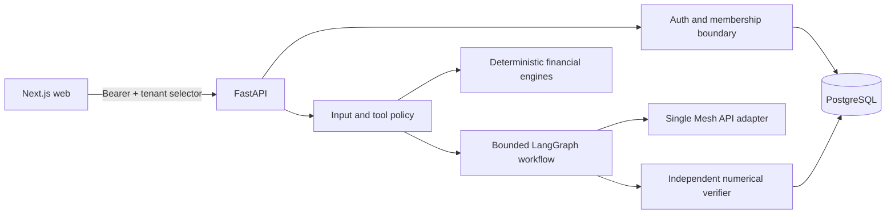

# FinPilot — Neuro-Symbolic Financial Decision Intelligence

FinPilot is an auditable, tenant-isolated financial intelligence system for Agent Arena 2026 Track 02. Deterministic Python engines own every authoritative calculation; specialized agents use the sponsor Mesh API only for bounded semantic reasoning. Model output can explain and propose, but it cannot alter identity, permissions, financial records, or verification policy.

The repository is under active milestone development. [Implementation status](docs/IMPLEMENTATION_STATUS.md) is the source of truth for verified and blocked capabilities—screens never present unfinished features as live.

## Foundation quickstart

Prerequisites: Python 3.12 (managed by uv), uv, Node 22, Corepack, Docker with Compose, and Git.

```bash
cp .env.example .env
# Replace SESSION_SECRET with a random 32+ character value.
make setup
make lint typecheck test security-test
make docker-up
curl http://localhost:8000/health
open http://localhost:3000
```

`MESH_API_KEY` and a verified organizer-supported `MESH_MODEL` are necessary only for live agent inference; no model provider fallback exists. Tests use an explicitly injected fake Mesh transport. Never place real secrets in committed files.

## Current API contract

- `GET /health`: process liveness without dependency claims.
- `GET /ready`: database readiness.
- `POST /api/v1/auth/register`: creates a user, household tenant, and owner membership.
- `POST /api/v1/auth/login`: returns a short-lived bearer token.
- `GET /api/v1/auth/me`: lists only the authenticated user's tenant memberships.
- `GET|POST /api/v1/accounts`: requires bearer auth and `X-Tenant-ID`; membership is checked server-side.
- `POST /api/v1/accounts/{account_id}/transaction-uploads`: validates and idempotently imports a mapped UTF-8 CSV.
- `GET /api/v1/transactions`: paginated, tenant-scoped persisted ledger.
- `PATCH /api/v1/transactions/{id}/category`: human correction with immutable correction lineage.

Interactive OpenAPI is at `http://localhost:8000/docs` in local development.

## Architecture



PostgreSQL is the production/local integration datastore. SQLite is used only as a fast isolated transport in unit/integration tests; it is not a production fallback. Local Compose runs migrations as a one-shot dependency before the API starts.

## Development gates

```bash
make lint
make typecheck
make test
make security-test
docker compose config
git diff --check
```

See [repository instructions](AGENTS.md), [threat model](docs/security/threat-model.md), and [local deployment](docs/deployment/local-docker.md).

The browser workspace at `/transactions` signs in without persisting its bearer token, accepts an explicit JSON column mapping, displays row errors and duplicate counts, and renders only transactions returned by the authenticated API. The versioned golden statement in `evaluation/datasets/phase2_golden.csv` contains synthetic salary, expense, transfer, refund, duplicate, missing-balance, malformed-date, and prompt-injection-like description cases.

## Security posture and limitations

FinPilot performs no transfers, trades, purchases, bank modifications, or arbitrary code/tool execution. Tenant identifiers from requests select a context only after database-backed membership verification. CSV, chat, model, and tool content remain untrusted data. Financial recommendations and complete governance functionality are not yet available and are tracked explicitly in the implementation status.

No deployment, live Mesh call, official hackathon check, or security certification is implied by this repository alone. Use synthetic data until the privacy and retention controls in later milestones are verified.
