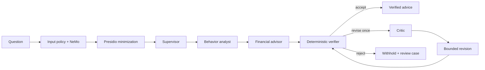

# Agent workflow

The supervisor receives a fixed context assembled from authorized snapshot, forecast, and optional scenario records. The analyst explains patterns; the advisor proposes typed options; the critic may request one correction. Semantic roles call Mesh through one adapter and have no database, shell, arbitrary network, or money-movement tools.

## Semantic categorizer

Categorization runs before analysis, outside the advice graph.

1. Keyword rules label each imported row. Rows they cannot place are marked `mesh_required`.
2. A categorization run sends up to 40 distinct labels for those rows to the categorizer agent through the same Mesh adapter, NeMo output rail and Presidio minimization. Rows answered by an earlier run are not sent again.
3. The agent returns one category and a confidence for each `label_id`, under a strict JSON Schema whose category enum is the fixed list.
4. Code applies a proposal only when all of these hold:
   - the category is allowed for the row's debit or credit direction
   - it is not the "still unclear" fallback
   - its confidence is at least 7000 bps

   Applied rows become `mesh` with confidence capped at 8500 bps. The run persists every answer, applied or not, as a `categorization_decisions` row with the previous category.
5. A human correction made before or during the call always wins.

The agent never sees amounts and cannot change kinds, transfers, refunds or balances.

The verifier is ordinary Python. It checks evidence identifiers, currencies, amounts, confidence, forbidden certainty, and deterministic constraints. Rejected output is withheld; the service persists reasons, exact governance artifact IDs, and a human-review case.

