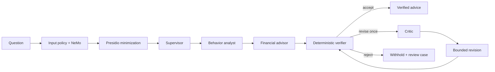

# Agent workflow

The supervisor receives a fixed context assembled from authorized snapshot, forecast, and optional scenario records. The analyst explains patterns; the advisor proposes typed options; the critic may request one correction. Semantic roles call Mesh through one adapter and have no database, shell, arbitrary network, or money-movement tools.

The verifier is ordinary Python. It checks evidence identifiers, currencies, amounts, confidence, forbidden certainty, and deterministic constraints. Rejected output is withheld; the service persists reasons, exact governance artifact IDs, and a human-review case.

