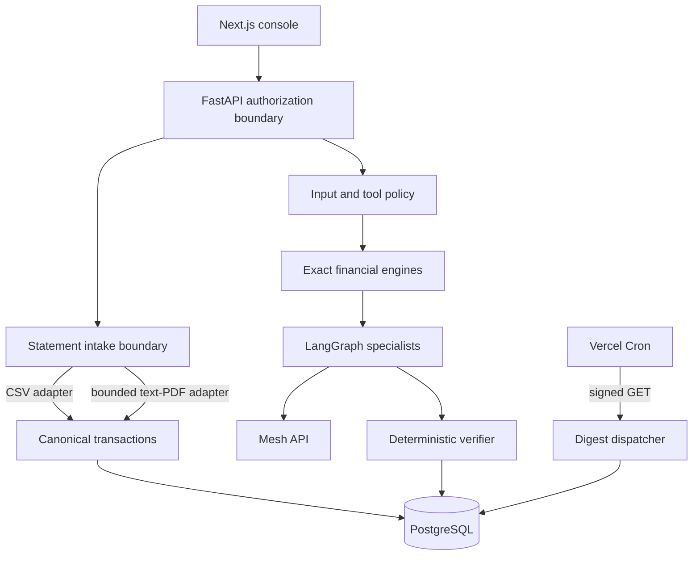

# System design

FinPilot separates financial truth from probabilistic explanation. The browser never supplies trusted tenant identity; FastAPI derives membership from the access token and verifies the selected tenant. PostgreSQL stores source rows, immutable calculations, graph/audit records, governance lineage, and scheduled work.

Trust boundaries are browser/API, statement parser/application, application/database, and guarded application/Mesh. Uploaded filenames and browser MIME values are claims only: the intake boundary detects bytes, requires claim consistency, applies size and PDF structure budgets, rejects active/encrypted/scanned PDFs, and records parser provenance. Untrusted CSV/PDF descriptions, user questions, model output, and tool content never gain instruction authority. Mesh receives only minimized, authorized context. Financial values remain integer minor units and are checked independently before advice release.

The API is stateless apart from PostgreSQL. Migrations run before startup. A daily cron invocation claims due weekly preferences with row locks and unique keys; no scheduler runs inside request workers.

